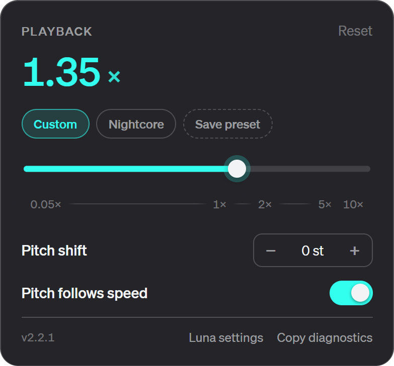

# Playback Kit for TIDAL Luna

A [TidaLuna](https://github.com/Inrixia/TidaLuna) plugin that adds speed, pitch and presets to the TIDAL desktop player.

A pill beside the volume control shows the live rate and opens a log-scaled speed slider, an independent pitch shifter, and presets — including a built-in **Nightcore** preset.




## Install

1. TIDAL → **Luna Settings → Plugin Store** → add:

   ```
   https://github.com/kyoto-aircon/tidaluna-playback-kit/releases/download/latest/store.json
   ```

2. Install **Playback Kit** and enable it.

## Features

- **Speed** — `−` / `+` steppers and a log-scaled slider; range and snap are configurable (defaults `0.05×` – `10×`, step `0.05×`).
- **Pitch follows speed** — rate-based chipmunk / slow-mo, YouTube-style pitch preservation by default.
- **Pitch shifter** — independent `−12…+12` semitone offset through a Web Audio worklet, with the rate untouched. Mutually exclusive with *Pitch follows speed*: turning one on turns the other off.
- **Presets** — save the current speed/pitch as a named preset, apply one with a click, delete custom ones. While a preset is active the playback controls are locked; choose **Custom** to edit again.
- **Preset editing** — rename, overwrite from the current state, and reorder custom presets in Luna settings; Nightcore stays fixed at the top and cannot be edited or removed.
- **Config file** — settings and presets live in a versioned JSON file inside TIDAL's userData folder (`playback-kit/config.json`), editable outside Luna and backed up by copying. Settings autosave 300 ms after changes; **Reload** re-reads the file, **Import…/Export…** just replace/copy it through a file dialog.
- **Nightcore** — the built-in preset (cannot be removed): `1.35×` with pitch following speed.
- **Theme-aware** — the popover mounts inside TIDAL's app root (`#wimp`) and every colour/font comes from TIDAL's own design tokens and inherited styles. No hardcoded palette or px font sizes: colours, fonts and the rem type scale follow TIDAL, so token/theme changes propagate.
- **Luna settings shortcut** — the popover footer has **Luna settings**, which opens the settings page on the Plugins tab and scrolls to this plugin's card.
- **Lossless fallback with a way back** — on the native player the popover explains why speed/pitch can't apply and offers **Use browser player** (High quality); it remembers your previous quality and shows **Restore …**.
- **Scrubber stays honest** — at any rate other than 1× the plugin re-feeds the real position to TIDAL so audio and progress bar don't drift.
- **Clean unload** — disabling restores `1×`, no pitch shift, and removes the UI.

## Caveats

- Chromium clamps effective playback to **0.0625× – 16×**. Speeds below `0.0625×` are selectable but play at that floor.
- TIDAL desktop plays **LOSSLESS / HI_RES through a native audio backend** with no media element or rate API. Speed and pitch need the shaka/browser player; the popover offers the switch.
- The **pitch shifter is experimental**. It needs `AudioContext.createMediaElementSource`, so it fails gracefully if TIDAL already connected the element or if the stream is DRM-protected. Status is shown in the popover and in diagnostics; audio never breaks, it just stays unshifted.
- Pitch-shift quality is a granular delay line: fine for small offsets and nightcore, artefacty at the extremes.

## Troubleshooting / diagnostics

Enable **Developer mode** in Luna settings first; then open the pill → **Copy diagnostics**, or use the same action in Luna settings. While it is off, nothing is logged and the buttons stay hidden. The report includes:

- plugin version, URL, UA, settings and active preset
- detected player kind (`native` / `shaka` / `browser`), native component API
- pitch engine status (`idle` / `waiting` / `running` / `unavailable` + reason), `mediaKeys` presence
- selector counts, every media element's state, a 1.5 s progression probe (`observedRate` vs `expectedRate`)
- resolved design tokens (accent, surfaces, borders, warning/danger, `--baseFontSize`, `--baseLineHeight`) plus computed footer / utility / volume / quality / progress styles, for theme mismatches
- scrubber UI time vs actual media time
- the last 500 log lines

DevTools exposes `window.__playbackSpeed` (`logs()`, `report()`, `copy()`, `selectors()`, `playerKind()`); console entries use the `[PlaybackKit]` prefix.

## Config file

Everything persistent is in one versioned JSON file, in TIDAL's Electron `userData` folder:

- Windows: `%APPDATA%/TIDAL/playback-kit/config.json`
- macOS: `~/Library/Application Support/TIDAL/playback-kit/config.json`
- Linux: `~/.config/TIDAL/playback-kit/config.json`

The exact path is shown in **Luna settings → Playback Kit → Config file**. Luna settings also has **Show folder**, **Reload**, **Import…** and **Export…**.

```json
{
  "version": 1,
  "settings": {
    "speed": 1.35,
    "pitchShifts": true,
    "pitchSemitones": 0,
    "presetId": "nightcore",
    "developerMode": false,
    "bounds": { "min": 0.05, "max": 10, "step": 0.01 }
  },
  "presets": [
    { "id": "custom-abc", "name": "Practice", "speed": 1.2, "pitchShifts": false, "pitchSemitones": 2 }
  ]
}
```

`nightcore` is implicit and must not be added to `presets`. Edit the file with TIDAL closed (or press **Reload** after editing), keep `version` at `1`, and back it up by copying the file.

The first config read asks Luna to allow the plugin's native module **fs** access; **Import…/Export…/Show folder** ask for **electron** access the first time they are used. Both are cached by Luna's trust store; deny them and the plugin falls back to browser storage.

## Development

```sh
npm install
npm test          # node:test via tsx
npm run build     # dist/store.json + dist/kyoto-aircon.playback-kit.{mjs,json,map}
npm run serve     # http://127.0.0.1:3000 for live reload
GH_TOKEN=... npm run release   # publish dist/* to the mutable `latest` release
```

For a local dev loop, add `http://127.0.0.1:3000` as a store URL in Luna.

### How it works

- `src/speed.ts` — snapping, clamping, log-scale mapping, ticks.
- `src/pitch.ts` — semitone clamp, labels, `2^(n/12)` ratio.
- `src/state.ts` — persisted settings (speed, pitch mode, semitones, active preset); migrates the old Playback Speed key.
- `src/presets.ts` — built-in Nightcore + custom presets, persisted.
- `src/mediaController.ts` — sets `playbackRate` / `defaultPlaybackRate` / `preservesPitch` on TIDAL's hidden video elements and re-asserts after track loads.
- `src/pitchEngine.ts` / `src/pitchWorklet.ts` — Web Audio graph and granular pitch-shift worklet.
- `src/playerKind.ts` / `src/nativePlayer.ts` — player detection and the native backend probe.
- `src/timeSync.ts` — keeps TIDAL's scrubber aligned at non-1× rates.
- `src/control.ts` / `src/Settings.tsx` / `src/styles.ts` — pill, popover, settings, theme tokens.

## License

MIT
