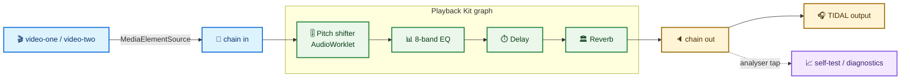
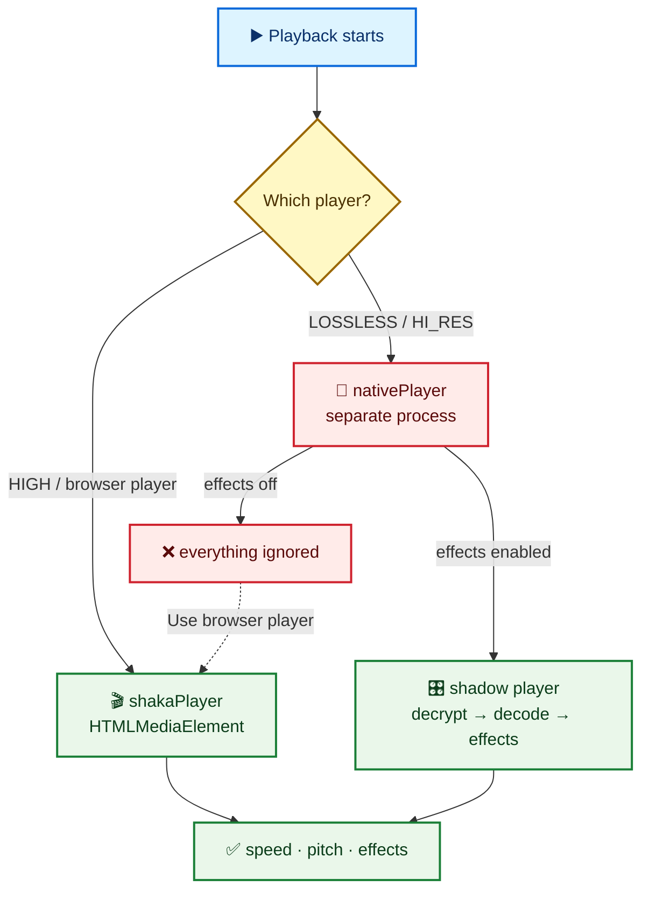

# Playback Kit <sub>for TIDAL Luna</sub>

[](https://github.com/kyoto-aircon/tidaluna-playback-kit/releases/latest)
[](LICENSE)


Speed, pitch, effects and presets for the TIDAL desktop player.

<p align="center">
  
</p>

A pill sits next to the volume control and shows the live rate. Click it for a log-scaled
speed slider, an independent pitch shifter, presets (including **Nightcore**), and the
current audio chain — all following TIDAL's theme, fonts and type scale.

## Install

1. TIDAL → **Luna Settings → Plugin Store**
2. Add this store URL:

   ```
   https://raw.githubusercontent.com/kyoto-aircon/tidaluna-playback-kit/release/store.json
   ```

3. Install **Playback Kit** and enable it.

> The store is served from the `release` branch on raw.githubusercontent.com because GitHub’s
> `releases/download/latest` endpoint intermittently returns 504, which makes Luna load nothing.

## What you get

| | |
|---|---|
| 🎚️ **Speed** | `−` / `+` steppers and a log slider. Range and snap are configurable (default `0.05×`–`10×`, step `0.05×`). The thumb moves smoothly, the rate snaps to your step. |
| 🎵 **Pitch follows speed** | Rate-based chipmunk / slow-mo. Off by default, so pitch is preserved like YouTube. |
| 🎼 **Pitch shifter** | Independent `−12…+12 st` offset. The browser player uses Signalsmith Stretch (WASM, live input) for independent pitch; speed stays on the element playbackRate. Native lossless is parked while it is stabilized. Mutually exclusive with *Pitch follows speed*. |
| 📊 **8-band EQ** | Vertical sliders at 62/125/250/500 Hz and 1/2/4/8 kHz, ±12 dB, with a Flat action. |
| 🌐 **8D audio** | Stereo chorus (opposite-phase delays on L/R) plus LFO auto-pan and a dry/wet mix, so the mix circles your head. Rate/depth for pan and pitch. |
| 🥁 **Bass boost** | Parallel 90 Hz shelf up to +24 dB, 45 Hz sub shelf, saturation drive for dirty kicks, and a safety limiter at the end of the chain. |
| ⏱️ **Delay** | 20–2000 ms, feedback and wet mix. |
| 🏛️ **Reverb** | Generated impulse response, 0.2–8 s decay and wet mix. |
| ⭐ **Presets** | Save speed, pitch and effects. Ten built-ins showcase the features — Nightcore, Daycore, Slowcore, Chipmunk, Vaporwave, Big Bass, Submerge, 8D Orbit, Dub Echo, Clear Voice — hide them all with one switch if you only want your own. Editing anything while a preset is active marks it with `*` (unsaved). **Save preset** pre-fills the active name: same name overwrites a custom preset, a built-in pre-fills `<name> (edited)` to save a copy. Choose **Custom** to clear it. |
| 🎨 **Theme-aware** | Colours, fonts and rem sizes come from TIDAL's own tokens and the app root — TidaLuna themes apply automatically. |
| 🧭 **Honest scrubber** | At any rate other than 1× the plugin re-feeds the real position so audio and progress bar stay aligned. |
| 🩺 **Developer mode** | Off by default. Enables logs, Copy diagnostics, an **audio engine self-test** that measures captured RMS, and native stream/bridge blocks (signed URLs redacted). |
| 🎛️ **Native processing** | Experimental. Speed, pitch and effects run on the same FLAC the native player uses; TIDAL keeps the queue/clock and the native renderer is paused at speeds other than 1×. One extra download per track, prefetched where possible. |

## How it works

Playback Kit owns one Web Audio graph. Pitch, EQ, delay and reverb are nodes in it, in that
order; nothing else in the app creates a competing `MediaElementSource`.



### The two TIDAL players

TIDAL routes audio differently depending on quality. This is the single biggest source of
"it does nothing" reports.



On the native player the popover shows a state-driven **Native lossless** card: processing off /
on / preparing / ready · rate · Signalsmith / failed, with an **Enable processing** toggle and
**Use browser player**. Enabling turns on the shadow player: the plugin captures the stream
descriptor from TIDAL's player, downloads the same lossless stream, decrypts it (`OLD_AES`) and
decodes it into the pitch/effects graph. Native speed/pitch use **Signalsmith Stretch** (official
MIT JS/WASM AudioWorklet), so rate and pitch are independent and high quality; the browser player
uses Signalsmith live input for independent pitch; speed stays on the element playbackRate, so the browser path remains stable. At 1× the native renderer is muted and stays the clock;
at other speeds it is paused, the buffer becomes the clock, and the native renderer is resumed
near the end so TIDAL emits `completed` and advances the queue. Each following track is prefetched
while the current one plays. **Use browser player** still switches TIDAL to High.

No **electron** grant is needed for this: the stream is captured in the renderer and the
main-process bridge only uses `fetch`/`crypto`. Only the config file dialogs ask for electron.

## Presets

A preset is a snapshot of **speed + pitch mode + pitch offset + all effects**.

- Built-ins (cannot be edited or removed):
  **Nightcore** 1.35× pitch-up · **Daycore** 0.85× + light reverb · **Slowcore** 0.8× + reverb ·
  **Chipmunk** 1.6× pitch-up · **Vaporwave** 0.7× + reverb + delay · **Big Bass** EQ + bass drive ·
  **Submerge** 0.95× + bass + 8D · **8D Orbit** auto-pan + pitch wobble · **Dub Echo** feedback delay ·
  **Clear Voice** 1.15× + presence EQ.
- **Built-in presets** switch in Luna settings hides them entirely; an active built-in drops back to Custom.
NaN

## Config file

Everything persistent lives in one versioned JSON file in TIDAL's Electron `userData` folder:

| OS | Path |
|---|---|
| Windows | `%APPDATA%/TIDAL/playback-kit/config.json` |
| macOS | `~/Library/Application Support/TIDAL/playback-kit/config.json` |
| Linux | `~/.config/tidal-hifi/playback-kit/config.json` |

The exact path is in **Luna settings → Playback Kit → Config file**, with **Copy path**, **Show
folder**, **Reload**, **Import…** and **Export…**.

```json
{
  "version": 1,
  "settings": {
    "speed": 1.35,
    "pitchShifts": true,
    "pitchSemitones": 0,
    "presetId": "nightcore",
    "developerMode": false,
    "builtinPresets": true,
    "nativeEffects": false,
    "effects": {
      "eq": { "enabled": true, "bands": [4, 2, 0, -2, -1, 0, 2, 3] },
      "bass": { "enabled": true, "boost": 8, "sub": 4, "drive": 0.35, "mix": 0.7 },
      "eightD": { "enabled": true, "rate": 0.15, "panDepth": 0.9, "pitchRate": 0.35, "pitchDepth": 2, "mix": 1 },
      "delay": { "enabled": false, "timeMs": 250, "feedback": 0.25, "mix": 0.25 },
      "reverb": { "enabled": true, "decay": 3, "mix": 0.3 }
    },
    "bounds": { "min": 0.05, "max": 10, "step": 0.01 }
  },
  "presets": [
    {
      "id": "custom-abc",
      "name": "Practice",
      "speed": 1.2,
      "pitchShifts": false,
      "pitchSemitones": 2,
      "effects": { "eq": { "enabled": false, "bands": [0, 0, 0, 0, 0, 0, 0, 0] }, "delay": { "enabled": false, "timeMs": 250, "feedback": 0.25, "mix": 0.25 }, "reverb": { "enabled": false, "decay": 2, "mix": 0.25 } }
    }
  ]
}
```

`nightcore` is implicit and must not be added to `presets`. Settings autosave 300 ms after the
last change; edit the file with TIDAL closed or press **Reload** afterwards.

> The first config read asks Luna to allow the plugin's native **fs** access; **Import/Export/Show
> folder** ask for **electron** access once. Both are cached in Luna's trust store. If you deny
> them, the plugin falls back to browser storage and the file buttons stop working.

## Troubleshooting

| Symptom | Likely cause | What to do |
|---|---|---|
| Speed/pitch/effects ignored on native | TIDAL is on the native lossless player and native processing is off | Popover → **Enable processing**, or **Use browser player** (High quality) |
| Native processing pauses by itself | Fixed in 2.18.1: user play/pause intent is captured from TIDAL's player, so the plugin's own native pause for non-1× no longer stops the shadow | Update; if it persists, send diagnostics with `shadow.userPlaying`/`nativePaused` |
| Speed change feels laggy | Fixed in 2.18.1: changes are scheduled immediately (40 ms debounce) instead of waiting for the 250 ms tick | Update; Signalsmith still has a ~120 ms block, so a small latency is expected |
| Enabled native effects but nothing changed | The player was not patched before the current load, or no effects/pitch are active | Change track or restart TIDAL once; make sure an effect or pitch offset is on |
| Native processing is silent or you still hear native audio | Exclusive mode blocks per-app mute, or the stream failed to decrypt/decode | Check the `shadow` and `nativeProbe.track` blocks in diagnostics; turn the setting off to restore native audio |
| Native processing failed with `EncodingError` | Fixed in 2.18.3: HiRes decode kept three copies and could hit memory pressure | Update; a 96 kHz/24-bit 5-minute track is ~236 MB decoded |
| Speed on native stutters or the queue stalls near the end | 2.18.1 adds a 1.5 s end watchdog; some devices/paths still handle the seek differently | Check `shadow.ending`/`nativePaused` in diagnostics; flip to **Use browser player** for speed-critical listening |
| Effects/pitch still silent after switching | Web Audio capture blocked (DRM or element already connected) | Enable **Developer mode** → **Audio engine self-test**; `rms ≈ 0` means capture is blocked |
| Want to debug native lossless playback | The native player is a separate process; the plugin can only see its `media.load` command | Enable **Developer mode**, play a LOSSLESS track, then **Copy diagnostics**. The `nativeProbe` block shows the stream host/format and whether a 128 KiB range fetch returned `fLaC`. |
| Quality badge shows `96 kbps` | Older builds sent the wrong `SET_STREAMING_QUALITY` payload, so the quality never applied | Fixed in 2.14.2; otherwise pick **High** in TIDAL settings |
| Progress bar drifts from audio | Shouldn't happen — the plugin re-feeds the position at non-1× | If it does, enable Developer mode and send diagnostics |
| Pitch sounds artefacty | Granular shifter at large offsets | Use smaller offsets; a smooth algorithm is on the roadmap |
| Logs/buttons missing | Developer mode is off | Luna settings → Playback Kit → Developer |

## Credits

- Native pitch/time stretching uses [Signalsmith Stretch](https://github.com/Signalsmith-Audio/signalsmith-stretch) (MIT), via the official `signalsmith-stretch` JS/WASM release.
- TIDAL playback/queue integration is TidaLuna and the TIDAL desktop client; no TIDAL code is redistributed.

## Development

```sh
npm install
npm test          # node:test via tsx
npm run build     # dist/store.json + dist/kyoto-aircon.playback-kit.{mjs,json,map}
npm run serve     # http://127.0.0.1:3000 for live reload
GH_TOKEN=... npm run release   # publish dist/* to the mutable `latest` release
```

For a local dev loop, add `http://127.0.0.1:3000` as a store URL in Luna.

### Source map

```
plugins/PlaybackKit/src/
├─ index.ts            wiring: stores, controller, engine, scanner, config hydrate/save
├─ speed.ts            snapping, clamping, log-scale mapping, ticks
├─ state.ts            persisted settings + migration from Playback Speed
├─ presets.ts          built-in Nightcore + custom presets
├─ control.ts          the pill and popover
├─ mediaController.ts  playbackRate / defaultPlaybackRate / preservesPitch
├─ audioEngine.ts      single graph owner + analyser + worklet loader
├─ pitchEngine.ts      pitch shifter node (AudioWorklet)
├─ effectsEngine.ts    EQ → delay → reverb group
├─ audioSelfTest.ts    dev-only capture/RMS diagnostic
├─ playerKind.ts       native vs shaka vs browser detection
├─ timeSync.ts         keeps TIDAL's scrubber aligned at non-1×
└─ config.ts / config.native.ts / Settings.tsx / styles.ts
```

### Audio engine API (for effect plugins)

Playback Kit owns the renderer's only `MediaElementSource` and exposes a small graph API at
`window.__playbackKitAudio`:

```ts
{
  version: 1,
  ensureContext(): Promise<AudioContext>,
  loadWorklet(source: string, name: string): Promise<void>,
  attach(element: HTMLMediaElement): Promise<void>,
  insert(node: AudioNode, index?: number): Promise<void>,
  insertGroup(input: AudioNode, output: AudioNode, index?: number): Promise<void>,
  remove(node: AudioNode): Promise<boolean>,
  list(): AudioNode[],
  status(): { context, sampleRate, sources, nodes },
  measureRms(ms?): Promise<{ rms, peak, silent, samples, durationMs }>
}
```

Rules: use the shared context, never connect a node's output yourself (the engine rebuilds the
chain), and never create a second `MediaElementSource`.

## Caveats

- Chromium clamps effective playback to **0.0625×–16×**; below that you hear the floor.
- Pitch and effects require Web Audio capture. DRM-protected streams can be silenced when captured
  — the self-test tells you, and a TIDAL restart undoes the attachment.
- Pitch quality is a granular delay line for now: fine for nightcore and small offsets, artefacty
  at ±12 st.
- The Windows Store build of TIDAL itself is not supported by TidaLuna.

## License

MIT
